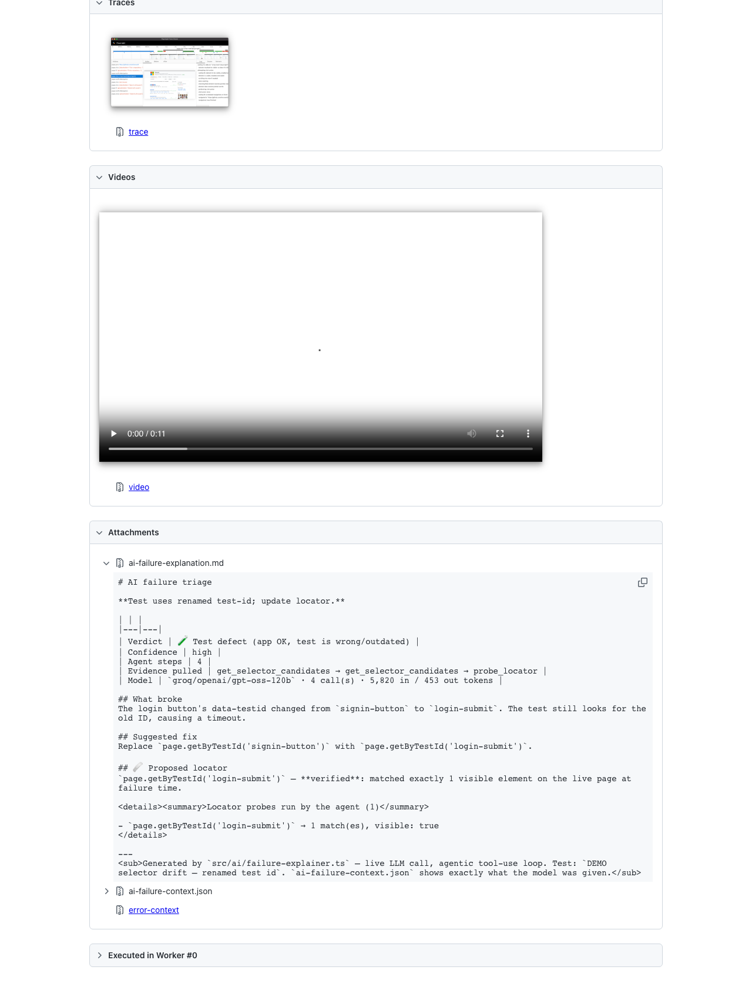

# Sample output — real runs, unedited

Everything in this folder was produced by `npm run demo` on 2026-10-30 against
the live target, with **Groq `openai/gpt-oss-120b`** (free tier) as the model.
Nothing is hand-written or mocked; each folder is a straight copy of `ai-reports/`
after that run.

**Start here:** [`html-report-ai-explanation.png`](html-report-ai-explanation.png)
— the explanation attached to a failing test inside the standard Playwright HTML
report, then [`demo-run-4/ai-report.md`](demo-run-4/ai-report.md) — the run-level
triage.

## The four runs

The demo specs ([`tests/demo/`](../tests/demo/)) fail on purpose, one failure
*shape* per bucket. Runs 1→4 are the same seven failures; the history
column grows (`F`, `FF`, `FFF`) because `.ai-history/` carried over — that is
the "learns over runs" input.

| Run | Bucketing | What went wrong | What I changed before the next run |
|---|---|---|---|
| [1](demo-run-1/ai-report.md) | 6/7 right | Selector drift diagnosed and **verified** (`login-submit`, 1 visible match) — but labelled `real_bug`. Missing-precondition fix inverted the assertion (`expect 401`). | Verdict rules rewritten around *where* the defect is; "never weaken an assertion to make a test pass". |
| [2](demo-run-2/ai-report.md) | 6/7 right | Correct diagnosis returned as markdown, not the tag block → parsed as `real_bug` by default. | One self-correction turn when the block is missing. |
| [3](demo-run-3/ai-report.md) | 6/7 right | Selector drift now correct — but the classifier filed the failed-then-passed test under `test_defect` (an over-correction of run 1's fix). The missing-precondition fix still inverted the assertion — partly my fault: the test explicitly cleared the token, and comments next to the failing line explained the trap. | Flaky outcome forced to `flaky_test` in code. Demo specs rewritten so no explanatory comment sits inside the source window the agent reads. |
| [4](demo-run-4/ai-report.md) | **7/7** | — | — |

## What to look at in run 4

- **Self-healing proposal** — `page.getByTestId('login-submit')`, ✅ verified: the
  agent called `probe_locator` against the live page before proposing it, and
  our code (not the model) checked the probe log. See
  [`explanations/demo-ui-demo-selector-drift-renamed-test-id.md`](demo-run-4/explanations/demo-ui-demo-selector-drift-renamed-test-id.md).
- **Agent path differs by failure** — 4 steps with selector tools for the
  locator failure; 1 step, no tools, where the error and source line were enough.
- **Missing precondition** — *"Add a login step before listNotes and keep the
  200 assertion"*, not "change it to 401".
- **Cost** — 12 calls, ~16k input tokens, free tier.

`ai-report.json` in each folder is the machine-readable version, including
every per-failure explanation and token count.
